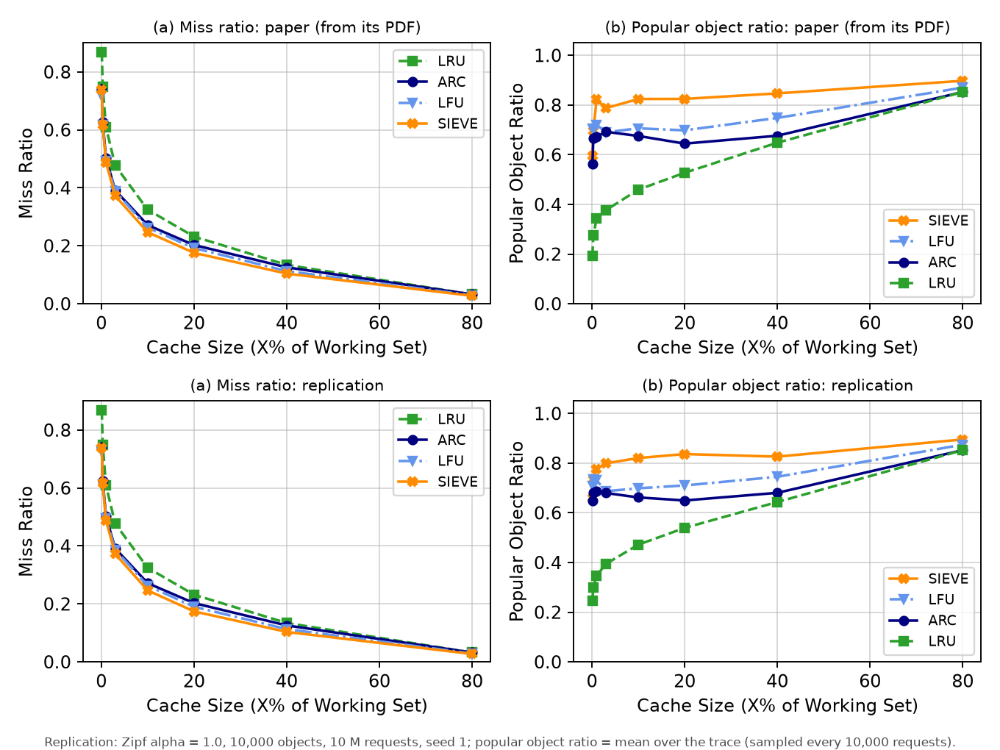

# Figure 8: miss ratio and popular object ratio on a Zipfian workload



Top: the paper's Figure 8, redrawn from the values in its PDF. Bottom: this replication
([fig8.png](fig8.png) alone). Every point: [../results/fig8_comparison.csv](../results/fig8_comparison.csv).

## What the figure is (paper §5.3)

LRU, LFU, ARC and SIEVE on a synthetic Zipfian workload with skew α = 1.0, at 8 cache sizes:

* **(a) miss ratio**;
* **(b) popular object ratio**: with cache size C (objects), the popular objects H are the C most
  frequent objects of the workload, and at time t the ratio is I_t = |H ∩ A_t| / C, A_t being
  the cache contents. It measures how much of the cache holds the truly popular objects.

## What was run

| | paper | this replication |
|---|---|---|
| workload | Zipf α = 1.0; size not stated | Zipf α = 1.0, **10,000 objects, 10,000,000 requests**, made with the artifact's own generator (`libCacheSim/scripts/data_gen.py`, `gen_zipf`) and a fixed seed |
| cache sizes | 8, plotted at 0–80% | 0.1, 0.3, 1, 3, 10, 20, 40, 80% of the 10,000 objects (read from the PDF; exactly cachesim's default size list) |
| simulator | libCacheSim | the snapshot in the authors' artifact (`external/NSDI24-SIEVE` @ `0346336`), object size ignored |
| (b) over time | one value per size, how it was averaged is not stated | the mean of I_t over the whole trace, sampled every 10,000 requests |

**Finding the workload size.** The paper does not give it. Three candidates from the artifact
were tried: the generator's defaults (1 M objects, 100 M requests), its README example
(10,000 objects, 1 M requests) and the sample trace it ships (`mydata/zipf/zipf_1.0`: 1,000
objects, 1 M requests). With 10,000 objects the small-cache miss ratios equal the paper's to 4
decimals; the large-cache ones depend on the number of requests (first-time misses), and
10 M requests gives the paper's LRU exactly at all 8 sizes (e.g. 0.0322 at 80%).

**Seeds.** The generator draws random requests; the paper does not give its seed. Seed 1 is
plotted; seeds 2–5 show how much a different random trace moves each point
(`results/fig8_raw.tsv`, `seeds_min`/`seeds_max` in the comparison table).

**(b) needs its own tool.** cachesim does not report cache contents. `fig8/popular_ratio.c`
creates the cache with cachesim's own `create_cache()`, feeds every request through
`cache->get()` like cachesim, and counts the popular objects in the cache with a read-only lookup
in the cache's hash table (ARC's ghost entries excluded). Its miss ratios are identical to
cachesim's at all 32 (algorithm, size) points. (`cache->find(cache, req, false)` is not used: in
this snapshot ARC's version dereferences a NULL object when the object is not cached.)

**Why the mean over time.** The paper's values at C = 10 and 30 objects (e.g. SIEVE 0.5957 and
0.6948) are not multiples of 1/10 or 1/30, so they are not a single snapshot; the tool also
prints the value at the end and the mean over the second half (`results/fig8_raw.tsv`).

## How to reproduce

```bash
fig8/build.sh                       # cachesim, libCacheSim, fig8/popular_ratio, Python venv
fig8/run.sh                         # 5 traces (seeds 1-5), 160 runs, about 30 seconds
.venv/bin/python -I fig8/extract_paper_fig8.py paper/nsdi24-sieve.pdf -o paper/fig8_paper_values.csv
.venv/bin/python -I fig8/plot_fig8.py
```

## Result vs paper

**(a) Miss ratio: the same curves.** LRU agrees with the paper to 0.0002 at every size, ARC to
0.0006, SIEVE to 0.0014; LFU too except at the smallest size (0.7290 vs 0.7176; LFU at tiny caches is the
point most sensitive to the random trace: 0.7264–0.7477 over the 5 seeds). The paper's value is
inside the 5-seed range for 26 of the 32 points. SIEVE has the lowest miss ratio from 1% up (the
paper: from 0.3% up; at 0.3% SIEVE and LFU differ by 0.001 in the paper, 0.004 here), LFU below
it at the smallest sizes, and LRU the highest at every size (ARC equal to it at 80%), as in the
paper.

| SIEVE miss ratio | 0.1% | 0.3% | 1% | 3% | 10% | 20% | 40% | 80% |
|---|---|---|---|---|---|---|---|---|
| paper | 0.7381 | 0.6168 | 0.4886 | 0.3723 | 0.2469 | 0.1756 | 0.1040 | 0.0273 |
| replication | 0.7382 | 0.6164 | 0.4879 | 0.3723 | 0.2466 | 0.1742 | 0.1034 | 0.0271 |

**(b) Popular object ratio: the same ordering, not the same numbers.** The order of the four
algorithms is the paper's at 7 of the 8 sizes: SIEVE holds the most popular objects from 1% up,
then LFU, ARC and LRU (LFU first at 0.1% and 0.3%, as in the paper). At 3% the paper has ARC
0.6923 just above LFU 0.6903, here LFU is above ARC. The values differ by 0.018 on average
(up to 0.09 at the smallest sizes, where one object is 10% of the cache), without a direction,
and the paper's own curve is uneven (SIEVE 0.822 at 1%, 0.787 at 3%, 0.824 at 10%). How the
paper sampled I_t over time is not stated, so these values cannot be reproduced exactly.

| SIEVE popular ratio | 0.1% | 0.3% | 1% | 3% | 10% | 20% | 40% | 80% |
|---|---|---|---|---|---|---|---|---|
| paper | 0.596 | 0.695 | 0.822 | 0.787 | 0.824 | 0.825 | 0.847 | 0.898 |
| replication | 0.662 | 0.734 | 0.776 | 0.799 | 0.821 | 0.837 | 0.826 | 0.895 |

The paper's conclusion holds in the replication: from 1% of the working set up, SIEVE has a lower
miss ratio than LRU, ARC and LFU and keeps more of the popular objects in its cache than the other
three.
