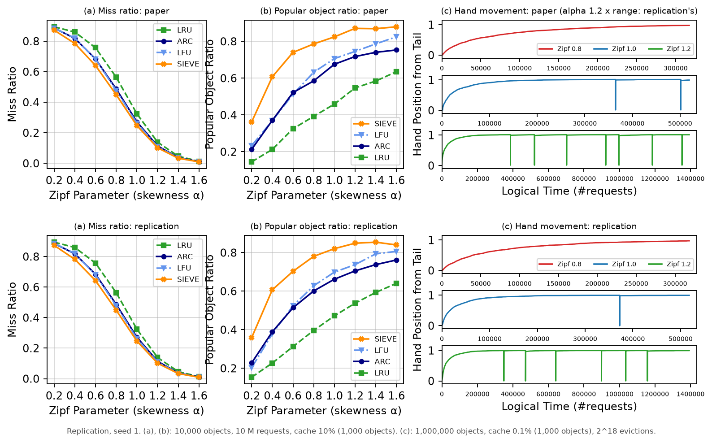

# Figure 9: varying the Zipf skew, and SIEVE's hand



Top: the paper's Figure 9, redrawn from the values in its PDF. Bottom: this replication, seed 1
([fig9.png](fig9.png) alone). (a)/(b) per point: [../results/fig9_comparison.csv](../results/fig9_comparison.csv);
(c): [../results/fig9c_summary.tsv](../results/fig9c_summary.tsv).

## What the figure is (paper §5.3)

* **(a) miss ratio** and **(b) popular object ratio** (see Figure 8) of LRU, LFU, ARC and SIEVE
  on Zipf workloads with skew α = 0.2, 0.4, …, 1.6, at the large cache (the paper: "we focus on
  results with large cache sizes").
* **(c) the position of SIEVE's hand** over time, from the tail (0) to the head (1), for
  α = 0.8, 1.0 and 1.2. The hand only moves when SIEVE evicts; it passes the objects it keeps,
  so it advances fast when most cached objects are popular, and it jumps back to the tail each
  time it has passed the head (the spikes).

## What was run

All tools come from the Figure 8 replication, included as the submodule `external/fig8`
(pinned; it pins the authors' artifact in turn): the artifact's own Zipf generator with a fixed
seed (`fig8/gen_trace.py`), and `fig8/popular_ratio`, whose miss ratios equal cachesim's. This
repository adds `fig9/sieve_hand.c`, which runs libCacheSim's SIEVE (created with cachesim's
`create_cache()`, every request through `cache->get()`) and logs the hand's position after every
eviction. Seeds 1–5; seed 1 is plotted, seeds 2–5 show how much a different random trace moves
each result.

| | the paper | this replication |
|---|---|---|
| (a), (b) workload | Zipf, size not stated | **10,000 objects, 10 M requests** (the Figure 8 workload: the paper's α = 1.0 points are exactly its Figure 8 values at 10%) |
| (a), (b) cache | "large" | 10% of the objects = 1,000 |
| (c) workload | not stated | **1,000,000 objects** (the generator's default) |
| (c) cache | not stated | **0.1% = 1,000 objects** (the paper's small cache) |
| (c) length | each curve ends at a different time | **2^18 = 262,144 evictions** |

**How (c)'s setup was found.** With 10,000 objects the hand moved in the opposite way to the
paper's (fastest at α = 0.8), for every cache size tried. A sweep over workload and cache size
(100 k / 1 M objects; caches of 10 to 3,000 objects) found the paper's pattern with 1 M objects
and a 1,000-object cache: no wrap for α = 0.8 and the paper's times to reach the head. The
paper's curves end at about 317.5 k (α 0.8) and 519.3 k (α 1.0) requests; at both points this
workload has made 263,144 misses, i.e. 1,000 to fill the cache plus 262,144 = 2^18 evictions.
Run for 2^18 evictions, the curves end at 317–318 k and 518–522 k requests (5 seeds), which also
gives the α = 1.2 subplot's range (1.38–1.39 M requests; the paper prints no ticks there).

## How to reproduce

```bash
fig9/build.sh                          # builds external/fig8 (simulator, generator, popular_ratio) and fig9/sieve_hand
fig9/run.sh                            # 55 traces, 160 runs for (a)/(b), 15 hand runs; about 2 minutes
external/fig8/.venv/bin/python -I fig9/extract_paper_fig9.py external/fig8/paper/nsdi24-sieve.pdf -o paper/fig9_paper_values.csv
external/fig8/.venv/bin/python -I fig9/plot_fig9.py
```

## Result vs paper

**(a) Miss ratio: the paper's curves.** Seed 1 differs from the paper by 0.0005 on average and
0.0033 at most; the paper's value is inside the 5-seed range at 27 of 32 points. SIEVE has the
lowest miss ratio at every α, and the order of the four algorithms is the paper's at 7 of 8 α
(at α = 0.2 the paper's LFU and ARC differ by 0.0001 and swap here).

**(b) Popular object ratio: the paper's ordering, values close.** SIEVE holds the most popular
objects at every α, as in the paper; the full order is the paper's at 6 of 8 α (at 0.2 and 0.6
LFU and ARC, within 0.01 of each other, swap). Values differ by 0.012 on average and 0.04 at
most; as for Figure 8, the paper does not say how it averaged this metric over time.

| SIEVE | α 0.2 | 0.4 | 0.6 | 0.8 | 1.0 | 1.2 | 1.4 | 1.6 |
|---|---|---|---|---|---|---|---|---|
| (a) paper | 0.8719 | 0.7851 | 0.6403 | 0.4491 | 0.2469 | 0.1015 | 0.0332 | 0.0095 |
| (a) replication | 0.8732 | 0.7818 | 0.6426 | 0.4487 | 0.2466 | 0.1014 | 0.0335 | 0.0096 |
| (b) paper | 0.362 | 0.608 | 0.740 | 0.786 | 0.824 | 0.871 | 0.869 | 0.879 |
| (b) replication | 0.359 | 0.607 | 0.703 | 0.781 | 0.821 | 0.849 | 0.854 | 0.840 |

**(c) Hand movement: the paper's behaviour.**

| | α 0.8 | α 1.0 | α 1.2 |
|---|---|---|---|
| wraps, paper | 0 | 2 | 7 |
| wraps, replication (seeds 1–5) | 0 every seed | 1–2 | 5–7 |
| hand first past 0.9, paper | ~204 k requests | ~95 k | ~92 k |
| hand first past 0.9, replication | 188–212 k | 88–109 k | 96–112 k |
| curve ends, paper | ~317.5 k | ~519.3 k | (no ticks) |
| curve ends, replication | 317–318 k | 518–522 k | 1.38–1.39 M |

As the paper describes: the first round is slow and slowest for the least skewed workload,
since many unpopular objects are evicted; afterwards the hand stays near the head; and the more
skewed the workload, the more often the hand completes a round. The exact times of the wraps
depend on the random trace (the paper's seed is unknown), e.g. α = 1.0 wraps at 365 k and 502 k
requests in the paper and at 372 k in seed 1.
