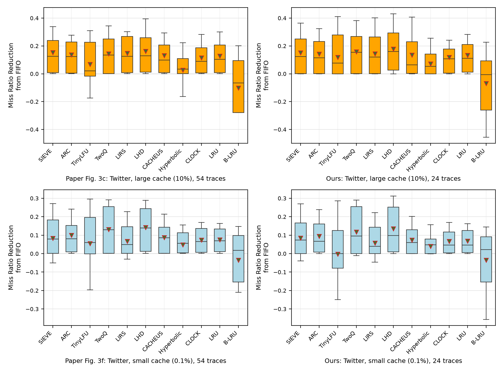

# SIEVE (NSDI'24) Figure 3c and 3f: a replication on the Twitter traces

This repository reproduces the **Twitter panels of Figure 3**, (c) and (f), of
*SIEVE is Simpler than LRU: an Efficient Turn-Key Eviction Algorithm for Web Caches*
(Zhang et al., NSDI'24): the miss ratio reduction from FIFO of 11 eviction algorithms, over the
Twitter cache traces, at a large (10%) and a small (0.1%) cache.

The other four panels (a, b, d, e) use the CDN1 and CDN2 datasets, which are proprietary and
cannot be downloaded, so they are not replicated here.

| panel | cache size | result | details |
|---|---|---|---|
| (c) | 10% of the trace footprint | [fig3c/fig3c.png](fig3c/fig3c.png) | [fig3c/README.md](fig3c/README.md) |
| (f) | 0.1% of the trace footprint | [fig3f/fig3f.png](fig3f/fig3f.png) | [fig3f/README.md](fig3f/README.md) |

## Result in one picture

Left: the paper's panels, redrawn from the exact values in its PDF. Right: this replication.
Each row shares one y axis.



* **The pattern matches.** Rank correlation of the 11 algorithms' means with the paper's:
  0.96 (c) and 0.98 (f). LHD is best and B-LRU worst in both panels, in the paper and here.
  SIEVE's mean is within 0.003 of the paper's in both (0.150 vs 0.153; 0.085 vs 0.083).
* **Not every rank matches.** In (c) TwoQ moves from 4th to 2nd and SIEVE from 2nd to 3rd. In
  (f) SIEVE and CACHEUS swap 4th/5th. These algorithms are within 0.004–0.015 of each other.
  TinyLFU differs most from the paper in both panels.
* **On Twitter, SIEVE is not better than the state of the art.** LHD is above SIEVE in both
  panels and TwoQ is above it at the small cache, in the paper's own figure and here. SIEVE is
  competitive, not best. Details and per-trace counts are in the panel READMEs.

Full tables: [results/summary.md](results/summary.md), `fig3c/comparison.csv`, `fig3f/comparison.csv`.

## Method (following the paper's §4.1–4.2)

* **Simulator:** libCacheSim as shipped in the authors' artifact (`external/NSDI24-SIEVE`, git
  submodule pinned at `0346336`: the artifact plus a fix so it builds with GCC 15 / CMake 4;
  the simulator code is unchanged).
* **Algorithms:** FIFO (baseline), LRU, CLOCK, ARC, TwoQ, LIRS, LHD, CACHEUS, Hyperbolic,
  TinyLFU, SIEVE, and B-LRU (LRU that admits an object only on its second request,
  `lru -a bloom-filter`). Default parameters. In this snapshot `tinyLFU` is W-TinyLFU with a
  1% window and an SLRU main cache.
* **Object size is ignored** (`--ignore-obj-size 1`). The cache size is a fraction of the trace's
  footprint (number of unique objects): **10%** (large) and **0.1%** (small).
* **Metric:** reduction = (mr_FIFO − mr) / mr_FIFO, or (mr_FIFO − mr) / mr when the algorithm
  is worse than FIFO, so it stays in [−1, 1]. FIFO runs on the same trace at the same size.
* **Plot:** box = P25–P75, whiskers = P10–P90, line = median, triangle = mean.
* **Paper values** for comparison are read from the vector drawing in the PDF
  (`scripts/extract_paper_fig3.py` → `paper/fig3_paper_values.csv`; the axis calibration
  residual is 0).

## Which traces: 24 of the 54 Twitter clusters

The paper uses all 54 Twitter clusters. This replication uses **clusters 1–24**, the first 24 by
number. They were run in that order, before any result was compared with the paper, so the
subset was not chosen to fit. With fewer clusters the result is noisier: the order of
algorithms whose means are close can differ from the paper's. Running clusters 25–54 (about 5–6 more
hours) is supported by the same scripts (`manifests/twitter.tsv`).

## Scaling the traces down

Each simulation run had to finish in **under 2 hours** on an 11 GB laptop. The full Twitter
clusters are far too large for that: they total 195 billion requests and 10.6 billion objects. So
each cluster is scaled down, and the scale-down was checked so that it does not change the result.

**Measured limits** (Intel Core 7 240H, 8 threads, 11 GB RAM, WSL2): one run (11 algorithms × 2
cache sizes, plus a B-LRU pass) processes about 0.2–0.6 M requests/s and needs 6–9 GB. A trace with about 70 M
unique objects went past 11 GB. Each run is therefore held to **about 1 billion requests** and
**≤ 30 M unique objects**.

**Official sampled copies.** The trace collection (CMU PDL mirror of the libCacheSim datasets)
publishes every Twitter cluster in full and as spatially sampled copies: `sample10` keeps 10% of
the objects and `sample100` keeps 1%, with every request to a kept object. The reuse pattern of
each kept object is therefore unchanged.

**When sampling is safe: validation.** 7 clusters were simulated at both 10% and 1% sampling
(`results/validation/`, `scripts/compare_sampling.py`):

| cluster | unique objects in the 1% sample | mean change in reduction, large / small cache | SIEVE rank 10% → 1%, large / small |
|---|---|---|---|
| cluster35 | 1,279,330 | 0.0000 / 0.0002 | 1→1 / 1→1 |
| cluster10 | 695,235 | 0.0000 / 0.0000 | 1→1 / 1→1 |
| cluster45 | 654,573 | 0.0023 / 0.0051 | 2→2 / 3→3 |
| cluster26 | 122,054 | 0.0009 / **0.0780** | 1→1 / 4→3 |
| cluster3 | 62,378 | **0.0909** / **0.1057** | 2→1 / 2→1 |
| cluster7 | 44,584 | 0.0102 / **0.1126** | 5→5 / 6→4 |
| cluster49 | 16,113 | **0.0454** / **0.0766** | 5→4 / 11→8 |

With ≥ 650 K unique objects, sampling changes nothing that matters. With ≤ 122 K, a few hot
objects dominate and results shift by up to 0.11. One sampling level cannot fit all clusters:
their 1% samples range from 1,282 to 52 M unique objects.

**The rule** (`scripts/choose_twitter.py`), applied to each cluster separately:

1. Use the least-sampled version (full → sample10 → sample100) whose whole trace has ≤ 1 B
   requests and ≤ 30 M unique objects.
2. If that version has < 500 K unique objects (the small cache would hold < 500 objects), use instead the
   least-sampled version with ≤ 30 M objects and simulate only its **first 1 billion requests**
   (clusters 1, 2, 8, 16, 18; only that prefix is downloaded, `scripts/download_prefix.sh`).
3. If even sample100 has > 30 M unique objects, sample it further inside cachesim (`-s 0.5`;
   cluster 15).

The version chosen for every cluster, with the reason, is in
[manifests/twitter_choice.tsv](manifests/twitter_choice.tsv). The per-cluster table of what was simulated
and how long it took is in [fig3c/README.md](fig3c/README.md#per-cluster-runs). The 24 runs took
7.0 h in total; the longest took 83 min.

**A simulator quirk found on the way:** Hyperbolic never finishes when the cache holds a single
object. This happened on the 1% sample of cluster1, where 0.1% of 1,282 objects is 1 object.
Rule 2 prevents such degenerate caches.

## Reproduce

```bash
git clone --recurse-submodules <this repo> sieve-fig3 && cd sieve-fig3
scripts/build.sh                                   # builds cachesim, sets up the Python venv

# 1. download the 1% samples, measure them, choose each cluster's version
scripts/download.sh $(for i in $(seq 1 24); do echo twitter/sample100/cluster$i.oracleGeneral.sample100.zst; done)
.venv/bin/python -I scripts/trace_stats.py data/twitter/sample100/cluster{1..24}.oracleGeneral.sample100.zst > results/twitter_s100_stats_24.tsv
.venv/bin/python -I scripts/choose_twitter.py results/twitter_s100_stats_24.tsv > manifests/twitter_choice_24.tsv
.venv/bin/python -I scripts/make_manifests.py twitter manifests/twitter_choice_24.tsv > manifests/twitter_24.tsv

# 2. download the chosen versions
scripts/download_twitter.sh manifests/twitter_choice_24.tsv

# 3. simulate, one cluster at a time (resumable: finished logs are skipped)
scripts/run_queue.sh manifests/twitter_24.tsv      # in a second terminal: scripts/watch_progress.sh

# 4. figures and comparison with the paper
.venv/bin/python -I scripts/extract_paper_fig3.py paper/nsdi24-sieve.pdf -o paper/fig3_paper_values.csv
.venv/bin/python -I scripts/make_figures.py
.venv/bin/python -I scripts/plot_side_by_side.py -o fig3cf_side_by_side.png
.venv/bin/python -I scripts/run_table.py > results/twitter_runs.md
```

Traces come from `https://ftp.pdl.cmu.edu/pub/datasets/twemcacheWorkload/cacheDatasets/twitter/`.
Every download is checked with `zstd -t`. The simulator is deterministic, so the same inputs give
the same miss ratios. On WSL, keep a terminal open while the queue runs: WSL shuts the Linux
VM down when no terminal is attached, and that kills background runs.

## Repository layout

| path | content |
|---|---|
| `external/NSDI24-SIEVE` | the simulator (git submodule, pinned) |
| `scripts/` | every step; each script documents its usage at the top |
| `manifests/` | the version chosen per cluster and the run queues |
| `results/raw/twitter/clusterN.log` | raw cachesim output of every run, with wall time and peak memory |
| `results/twitter.csv` | parsed miss ratios and reductions: one row per cluster × cache size × algorithm |
| `results/twitter_s100_stats.tsv` | exact requests and unique objects of each 1% sample |
| `results/validation/` | the 10% vs 1% sampling check |
| `results/summary.md`, `results/twitter_runs.md` | pattern checks vs the paper; per-cluster runs |
| `paper/` | the paper and its Figure 3 values read from the PDF |
| `fig3c/`, `fig3f/` | each panel: figure, plotted numbers, comparison with the paper, README |
| `data/` | traces (git-ignored) |

## Environment

Intel Core 7 240H (8 threads), 11 GB RAM + 8 GB swap, WSL2 (Linux 6.18), GCC 15.2, CMake 4.2,
zstd 1.5.0, Python 3.14 with the packages in `requirements.txt`.
