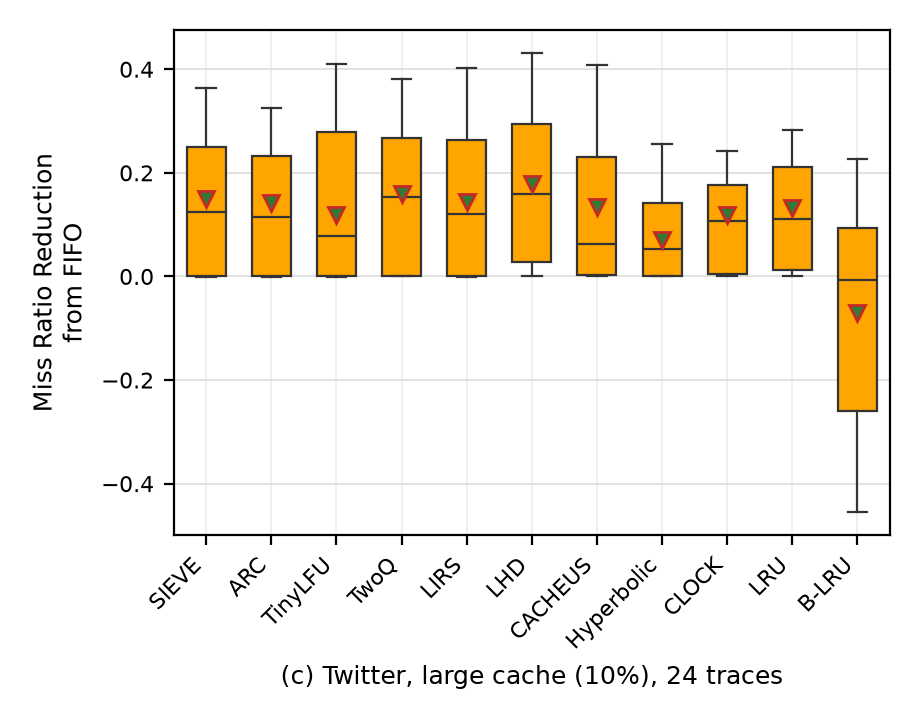

# Figure 3c: Twitter, large cache (10% of the footprint)



The paper's panel is redrawn from its exact values next to this one in
[../fig3cf_side_by_side.png](../fig3cf_side_by_side.png) (top row).

## What was run

| | paper | this replication |
|---|---|---|
| traces | all 54 Twitter clusters | clusters **1–24** (the first 24 by number, chosen before any result was compared) |
| trace size | full traces | each cluster scaled down to run in < 2 h on 11 GB RAM (table below) |
| cache size | 10% of the trace footprint (unique objects) | same |
| object size | ignored | ignored (`--ignore-obj-size 1`) |
| simulator | libCacheSim | the libCacheSim snapshot in the authors' artifact (`external/NSDI24-SIEVE` @ `0346336`) |
| algorithms | 11 + FIFO baseline | same: FIFO, LRU, CLOCK, ARC, TwoQ, LIRS, LHD, CACHEUS, Hyperbolic, TinyLFU, SIEVE, B-LRU |

Every cluster was simulated once with both cache sizes, so panels (c) and (f) come from the
same runs. How each cluster was scaled down, and why, is described in the
[top-level README](../README.md#scaling-the-traces-down).

## How to reproduce this panel

From the repository root, after `scripts/build.sh`:

```bash
# 1. measure the 1% samples and choose each cluster's version (or reuse manifests/twitter_choice_24.tsv)
scripts/download.sh $(for i in $(seq 1 24); do echo twitter/sample100/cluster$i.oracleGeneral.sample100.zst; done)
.venv/bin/python -I scripts/trace_stats.py data/twitter/sample100/cluster{1..24}.oracleGeneral.sample100.zst > results/twitter_s100_stats_24.tsv
.venv/bin/python -I scripts/choose_twitter.py results/twitter_s100_stats_24.tsv > manifests/twitter_choice_24.tsv
.venv/bin/python -I scripts/make_manifests.py twitter manifests/twitter_choice_24.tsv > manifests/twitter_24.tsv
# 2. download the chosen versions
scripts/download_twitter.sh manifests/twitter_choice_24.tsv
# 3. simulate (one cluster at a time; resumable; keep a WSL terminal open)
scripts/run_queue.sh manifests/twitter_24.tsv
# 4. plot and compare with the paper
.venv/bin/python -I scripts/make_figures.py
```

Each run writes `results/raw/twitter/clusterN.log`: the cachesim command's output, the
trace, sampling and request cap used, and the wall time and peak memory of each pass.

## Result vs paper

Mean, median and box (P25–P75) of the miss ratio reduction from FIFO. Rank is by mean (1 = best).
Paper values are read from the vector drawing in the paper's PDF
(`scripts/extract_paper_fig3.py`, calibration residual 0).

| algorithm | mean paper | mean ours | median paper | median ours | box paper | box ours | rank paper | rank ours |
|---|---|---|---|---|---|---|---|---|
| SIEVE | 0.153 | 0.150 | 0.126 | 0.123 | 0.007 – 0.239 | 0.001 – 0.251 | 2 | 3 |
| ARC | 0.137 | 0.142 | 0.123 | 0.115 | 0.005 – 0.228 | 0.001 – 0.232 | 5 | 5 |
| TinyLFU | 0.069 | 0.118 | 0.020 | 0.077 | -0.018 – 0.226 | 0.000 – 0.279 | 9 | 8 |
| TwoQ | 0.144 | 0.159 | 0.134 | 0.154 | 0.001 – 0.249 | 0.000 – 0.268 | 4 | 2 |
| LIRS | 0.148 | 0.144 | 0.126 | 0.121 | 0.008 – 0.267 | 0.001 – 0.264 | 3 | 4 |
| LHD | 0.163 | 0.179 | 0.129 | 0.159 | 0.011 – 0.258 | 0.027 – 0.294 | 1 | 1 |
| CACHEUS | 0.131 | 0.134 | 0.099 | 0.063 | 0.008 – 0.206 | 0.002 – 0.230 | 6 | 6 |
| Hyperbolic | 0.026 | 0.071 | 0.033 | 0.053 | 0.001 – 0.110 | 0.000 – 0.142 | 10 | 10 |
| CLOCK | 0.116 | 0.118 | 0.090 | 0.108 | 0.006 – 0.187 | 0.005 – 0.177 | 8 | 9 |
| LRU | 0.128 | 0.132 | 0.105 | 0.111 | 0.007 – 0.206 | 0.011 – 0.210 | 7 | 7 |
| B-LRU | -0.102 | -0.070 | -0.065 | -0.006 | -0.279 – 0.096 | -0.260 – 0.093 | 11 | 11 |

Rank correlation (Spearman) of the 11 means, ours vs paper: **0.96**.

### Does the pattern match?

**Yes, in shape; not in every rank.**

* Same as the paper: **LHD is best** (highest mean, median and box), **B-LRU is worst** and the
  only box that is mostly below 0, ARC / CACHEUS / LRU / Hyperbolic sit at the same ranks, and
  most boxes start near 0 (on some traces nothing beats FIFO).
* SIEVE's mean is within 0.003 of the paper (0.150 vs 0.153).
* Different: **TwoQ moves up from 4th to 2nd** (0.159 vs 0.144), which pushes SIEVE from 2nd to
  3rd and LIRS from 3rd to 4th. In the paper these three means are within 0.009 of each other,
  less than the spread between traces, so the order among them depends on the trace set.
  TinyLFU (0.118 vs 0.069) and Hyperbolic (0.071 vs 0.026) come out higher than in the paper.
  TinyLFU and CLOCK swap 8th/9th, by 0.0003 (0.1182 vs 0.1179).
* Using more of the 54 clusters brings the order closer to the paper's: with clusters 1–5 the
  rank correlation is 0.85, with 1–15 it is 0.83, from 1–17 onwards 0.95–0.97. No prefix of
  the 24 clusters reproduces the paper's order exactly.

### What it says about the paper's claim

The caption says SIEVE achieves "similar or better miss ratio reduction compared to
state-of-the-art algorithms". On Twitter at the large cache that is **"similar", not "better"**:
LHD is above SIEVE in the paper and here (the paper's §4.2 says so too: "LHD is the best
algorithm on the Twitter dataset, SIEVE scores second"). Per trace, SIEVE beats LHD on 5 of
the 24 clusters and loses on 16 (3 ties).

## Per-cluster runs

The same runs feed panel (f). Wall time is both cachesim passes (11 algorithms, then B-LRU), 8 threads.

| cluster | trace file simulated | requests | small cache (obj) | large cache (obj) | wall time | peak memory |
|---|---|---|---|---|---|---|
| 1 | `cluster1.oracleGeneral.first1000000000.zst` | 1,000,000,000 | 63 | 6,391 | 83 min | 6.1 GB |
| 2 | `cluster2.oracleGeneral.first1000000000.zst` | 1,000,000,000 | 1,352 | 135,292 | 9 min | 6.2 GB |
| 3 | `cluster3.oracleGeneral.zst` | 820,307,312 | 6,269 | 626,908 | 32 min | 7.6 GB |
| 4 | `cluster4.oracleGeneral.sample10.zst` | 338,164,835 | 10,661 | 1,066,102 | 12 min | 6.7 GB |
| 5 | `cluster5.oracleGeneral.sample100.zst` | 103,936,673 | 20,752 | 2,075,269 | 8 min | 8.6 GB |
| 6 | `cluster6.oracleGeneral.sample10.zst` | 823,684,757 | 2,140 | 214,050 | 25 min | 6.3 GB |
| 7 | `cluster7.oracleGeneral.zst` | 1,044,513,075 | 4,462 | 446,218 | 43 min | 7.5 GB |
| 8 | `cluster8.oracleGeneral.first1000000000.zst` | 1,000,000,000 | 267 | 26,724 | 70 min | 6.1 GB |
| 9 | `cluster9.oracleGeneral.sample10.zst` | 1,038,462,409 | 1,508 | 150,892 | 20 min | 6.0 GB |
| 10 | `cluster10.oracleGeneral.sample10.zst` | 13,916,365 | 6,956 | 695,679 | 1 min | 6.6 GB |
| 11 | `cluster11.oracleGeneral.sample10.zst` | 272,048,218 | 2,664 | 266,444 | 10 min | 6.3 GB |
| 12 | `cluster12.oracleGeneral.sample100.zst` | 26,506,121 | 20,949 | 2,094,948 | 4 min | 8.6 GB |
| 13 | `cluster13.oracleGeneral.sample100.zst` | 8,264,851 | 5,187 | 518,734 | 1 min | 7.6 GB |
| 14 | `cluster14.oracleGeneral.sample10.zst` | 310,715,660 | 6,936 | 693,643 | 7 min | 6.5 GB |
| 15 | `cluster15.oracleGeneral.sample100.zst` (+ cachesim `-s 0.5`) | 26,327,027 | 26,094 | 2,609,445 | 6 min | 8.9 GB |
| 16 | `cluster16.oracleGeneral.first1000000000.zst` | 1,000,000,000 | 8,323 | 832,351 | 33 min | 6.5 GB |
| 17 | `cluster17.oracleGeneral.sample10.zst` | 883,047,506 | 676 | 67,604 | 12 min | 7.6 GB |
| 18 | `cluster18.oracleGeneral.first1000000000.zst` | 1,000,000,000 | 4,437 | 443,713 | 27 min | 6.3 GB |
| 19 | `cluster19.oracleGeneral.sample100.zst` | 20,095,728 | 3,285 | 328,596 | 1 min | 7.5 GB |
| 20 | `cluster20.oracleGeneral.sample10.zst` | 322,149,748 | 8,972 | 897,254 | 6 min | 6.6 GB |
| 21 | `cluster21.oracleGeneral.sample100.zst` | 15,547,796 | 14,538 | 1,453,879 | 2 min | 8.0 GB |
| 22 | `cluster22.oracleGeneral.sample100.zst` | 20,030,642 | 4,029 | 402,959 | 1 min | 7.6 GB |
| 23 | `cluster23.oracleGeneral.sample100.zst` | 37,979,795 | 14,424 | 1,442,449 | 2 min | 8.1 GB |
| 24 | `cluster24.oracleGeneral.sample10.zst` | 328,062,779 | 1,215 | 121,525 | 5 min | 6.2 GB |

24 clusters, 11.45 billion requests, 7.0 h of simulation in total. Longest run 83 min, peak memory 8.9 GB.

Files in this folder: `fig3c.png` (the panel), `stats.csv` (the plotted P10/P25/median/P75/P90/mean
per algorithm), `comparison.csv` (ours vs paper, per algorithm).
