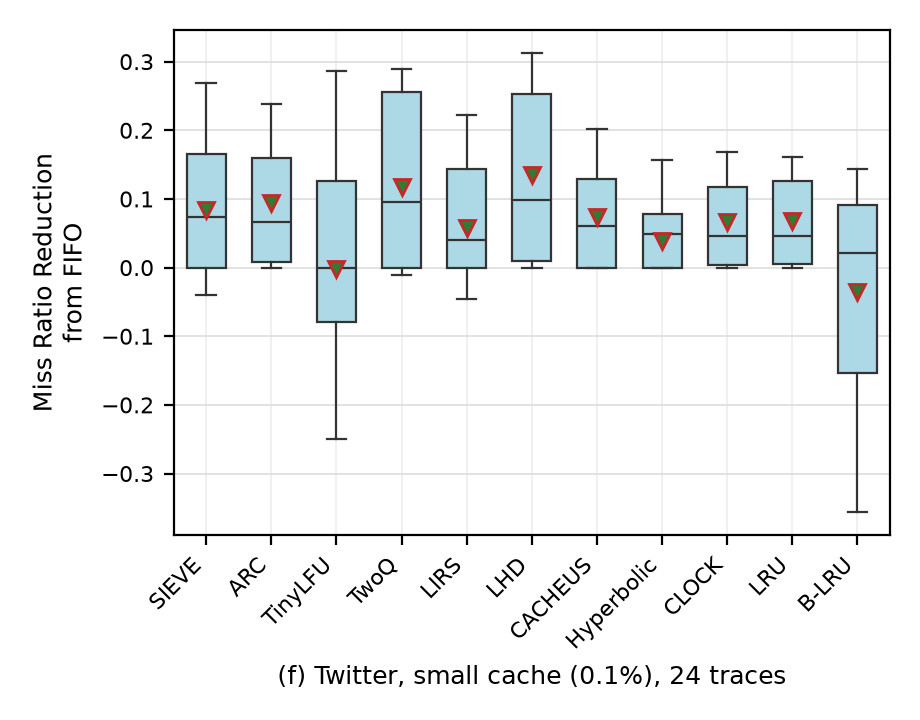

# Figure 3f: Twitter, small cache (0.1% of the footprint)

The paper's panel is redrawn from its exact values next to this one in
[../fig3cf_side_by_side.png](../fig3cf_side_by_side.png) (bottom row).

## What was run

These are the same runs as panel (c): each cluster was simulated once with both cache sizes.
See [../fig3c/README.md](../fig3c/README.md) for the setup table, the commands to reproduce and
the per-cluster table (trace version, requests, cache sizes, wall time, memory). The only
difference is the cache: **0.1%** of the trace's footprint (unique objects) instead of 10%.

## Result vs paper

Mean, median and box (P25–P75) of the miss ratio reduction from FIFO. Rank is by mean (1 = best).

| algorithm | mean paper | mean ours | median paper | median ours | box paper | box ours | rank paper | rank ours |
|---|---|---|---|---|---|---|---|---|
| SIEVE | 0.083 | 0.085 | 0.079 | 0.074 | 0.001 – 0.183 | 0.000 – 0.166 | 5 | 4 |
| ARC | 0.099 | 0.094 | 0.081 | 0.067 | 0.009 – 0.153 | 0.008 – 0.160 | 3 | 3 |
| TinyLFU | 0.055 | -0.002 | 0.060 | -0.000 | -0.002 – 0.196 | -0.079 – 0.126 | 9 | 10 |
| TwoQ | 0.130 | 0.117 | 0.129 | 0.096 | 0.001 – 0.256 | 0.000 – 0.255 | 2 | 2 |
| LIRS | 0.067 | 0.057 | 0.049 | 0.040 | 0.001 – 0.145 | 0.000 – 0.143 | 8 | 8 |
| LHD | 0.141 | 0.135 | 0.139 | 0.098 | 0.012 – 0.244 | 0.010 – 0.253 | 1 | 1 |
| CACHEUS | 0.087 | 0.074 | 0.086 | 0.060 | 0.002 – 0.143 | 0.000 – 0.130 | 4 | 5 |
| Hyperbolic | 0.048 | 0.039 | 0.055 | 0.048 | 0.004 – 0.113 | 0.000 – 0.079 | 10 | 9 |
| CLOCK | 0.074 | 0.066 | 0.065 | 0.046 | 0.007 – 0.136 | 0.004 – 0.117 | 7 | 7 |
| LRU | 0.075 | 0.068 | 0.069 | 0.046 | 0.011 – 0.134 | 0.006 – 0.126 | 6 | 6 |
| B-LRU | -0.036 | -0.035 | 0.017 | 0.022 | -0.154 – 0.098 | -0.154 – 0.091 | 11 | 11 |

Rank correlation (Spearman) of the 11 means, ours vs paper: **0.98**.

### Does the pattern match?

**Yes; 7 of the 11 ranks are identical.**

* Same as the paper: **LHD 1st, TwoQ 2nd, ARC 3rd**, with LHD's and TwoQ's boxes visibly taller than
  the rest; LRU, CLOCK and LIRS at 6th–8th; **B-LRU last** with a box reaching well below 0.
* SIEVE's mean is within 0.002 of the paper (0.085 vs 0.083).
* Different: SIEVE and CACHEUS swap 4th/5th (the paper's gap between them is 0.004).
  Hyperbolic and TinyLFU swap 9th/10th. **TinyLFU** is the clearest difference: its mean is
  about 0 here vs 0.055 in the paper, and its box reaches lower (P25 −0.079 vs −0.002). TinyLFU also
  differs in panel (c), in the other direction, so this looks like a systematic difference in
  how TinyLFU was configured or which version was used, not an effect of the trace sample.

### What it says about the paper's claim

At the small cache SIEVE is clearly **not** better than the state of the art on Twitter, in the
paper or here: LHD (0.141) and TwoQ (0.130) are well above SIEVE (0.083), and ARC and CACHEUS
are above it too in the paper. Per trace in this replication, SIEVE never beats LHD (0 better,
21 worse, 3 ties) and beats TwoQ on 5 clusters while losing on 17. The paper's text acknowledges
this only as "TwoQ and LHD sometimes outperform SIEVE".

## A note on the small cache size

0.1% of the footprint is a very small cache. For clusters with few unique objects it holds only
dozens to hundreds of objects (e.g. 63 for cluster1 and 267 for cluster8, even on the full,
unsampled trace prefix). With such caches, algorithms that reserve a small fraction of the
cache for new objects (TinyLFU's 1% window, LIRS's 1% queue) have almost no room. That is one
reason the small-cache results vary more between traces. The scaling-down rule never shrinks a
cluster below 500 K unique objects when a less-sampled version exists (see the
[top-level README](../README.md#scaling-the-traces-down)), so the small caches here are as
large as the 2-hour limit allows.

Files in this folder: `fig3f.png` (the panel), `stats.csv` (the plotted P10/P25/median/P75/P90/mean
per algorithm), `comparison.csv` (ours vs paper, per algorithm).
