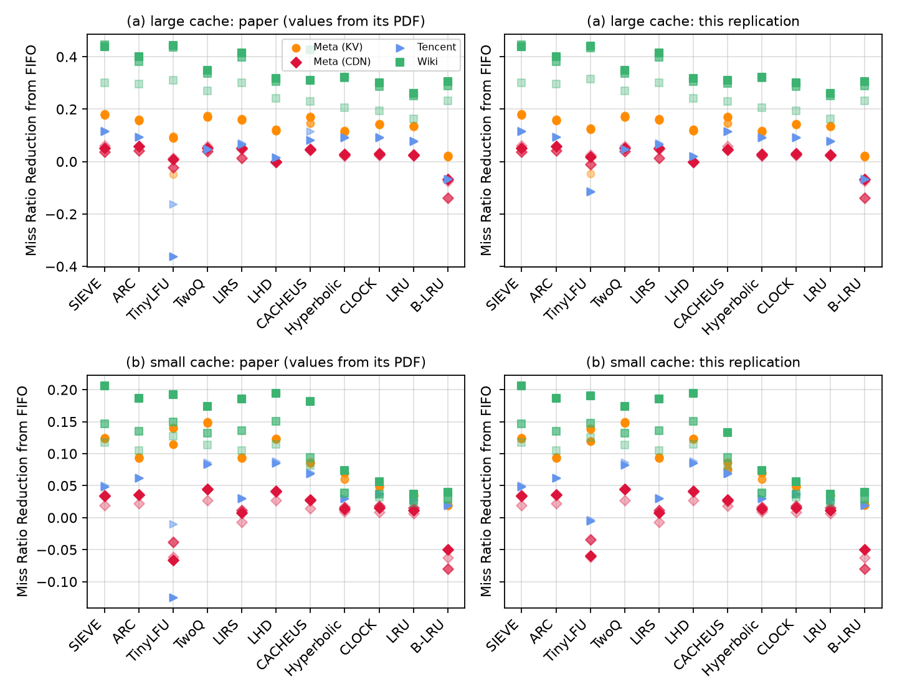

# SIEVE (NSDI'24) Figures 4 and 5: a replication

This repository reproduces **Figure 4** of
*SIEVE is Simpler than LRU: an Efficient Turn-Key Eviction Algorithm for Web Caches*
(Zhang et al., NSDI'24): the miss ratio reduction from FIFO of 11 eviction algorithms on every
trace of four public datasets (Meta KV, Meta CDN, Tencent Photo CDN, Wikimedia CDN), at a large
(a, 10% of the trace footprint) and a small (b, 0.1%) cache. Each dot is one trace.

Left: the paper's panels, redrawn from the exact values in its PDF. Right: this replication.
Details, how to reproduce, and every number: [fig4/README.md](fig4/README.md) and
[results/summary.md](results/summary.md).

## Result

* **SIEVE's rank among the 11 algorithms is the paper's on 25 of the 26 trace × panel points**,
  and the best algorithm is the paper's on the same 25.
* **SIEVE's miss ratio reduction equals the paper's to 4 decimals on every trace**
  (largest difference 0.0001). So do Hyperbolic, CLOCK and LRU; LIRS, TwoQ and ARC are within
  0.0003, B-LRU within 0.0011, LHD within 0.0052.
* The one different rank is Tencent photo2 at the large cache: SIEVE's value is the paper's
  (0.1146 vs 0.1147), but this simulator's CACHEUS reaches 0.1150 (paper: 0.0825) and so comes
  first by 0.0004. CACHEUS and TinyLFU are the only algorithms that differ from the paper by
  more than 0.006 anywhere; the cause could not be found (see fig4/README.md).
* The paper's text: "SIEVE outperforms all other algorithms on all four datasets at the large
  cache size" holds for the datasets' best traces but not for every trace, in the paper's own
  figure as here: ARC beats SIEVE on Meta CDN trace 1, CACHEUS on Meta CDN trace 2, TinyLFU on
  two Wiki traces. "When the cache size is small ... SIEVE is the best algorithm on the Wiki
  dataset. TwoQ and LHD are the best on Meta and TencentPhoto" is what both figures show.

## Method

* **Traces: exactly the paper's.** Totals match the paper's Table 1 (Meta KV 1,645 M requests /
  82 M objects vs 1,644 / 82; Meta CDN 231 / 76 vs 231 / 76; Tencent 5,649 / 1,038 vs
  5,650 / 1,038). Wiki: the three public traces each match one of the paper's Wiki dots exactly
  (Table 1's Wiki row does not add up for any combination of them).
  * Meta KV: Meta's five `202206` CacheLib KV traces from Meta's S3 bucket, converted with
    libCacheSim's `traceConv` the way the CMU mirror's merged file was made (checked record by
    record: identical, 1,665,685,869 records).
  * Meta CDN, Tencent Photo, Wiki: the oracleGeneral files of the CMU PDL mirror.
* **Simulator:** the libCacheSim snapshot in the authors' artifact (`external/NSDI24-SIEVE`
  @ `0346336`, unchanged except a build fix for newer compilers), default parameters, object
  size ignored. Cache sizes are what cachesim computes for 0.1% and 10% of the footprint.
* **Whole traces**, except Tencent Photo, which (like the paper, see below) uses a 10% spatial
  sample (`cachesim -s 0.1`). To fit whole traces into 11 GB, each trace's large-cache
  simulation is split into groups of algorithms run as separate cachesim processes. With
  several caches in one process, cachesim resets the random state to 0 for each cache, so the
  grouping does not change results (`results/validation/split_check.tsv`). A cachesim process
  with one cache seeds from the clock instead, which changes LHD; no LHD result here comes from
  a one-cache process.
* **Tencent = 10% sample, as in the paper.** On the sample, all algorithms except TinyLFU
  match the paper's Tencent values at the small cache to 4 decimals (LHD to 0.0002), and at the
  large cache all but TinyLFU, CACHEUS (photo2) and LHD (0.005); on the whole trace several do
  not (small cache, photo1: Hyperbolic 0.0465 vs 0.0304, B-LRU 0.0098 vs 0.0196). The
  whole-trace small-cache runs and a whole-trace large-cache run of FIFO, SIEVE, LRU and CLOCK
  are kept as a check.
* **B-LRU** on Tencent's whole trace uses `tools/blru_bitmap.c`: cachesim's "bloom-filter"
  admission keeps every object ever seen (> 11 GB for 529 M objects). The tool computes the same
  admission from the trace's next-access field with one bit per request; it gives cachesim's
  B-LRU results exactly at all 10 cache sizes tested.
* **Paper values** are read from the vector drawing in the PDF
  (`scripts/extract_paper_fig4.py`; 286 dots; the y axis is calibrated on the grid lines,
  residual 3e-6).

## Figure 5

Figure 5 (the best algorithm per dataset) is drawn from the per-trace results of Figures 3
and 4; no extra simulation. The Meta, Tencent and Wiki bars equal the paper's except Tencent at
the large cache (SIEVE 1/2 instead of 1, the CACHEUS difference above); Twitter uses the 24
clusters of the Figure 3 replication and is close to the paper's 53. Details:
[fig5/README.md](fig5/README.md).

## Layout

| path | what |
|---|---|
| `fig4/` | figures, panel README, comparison tables (`comparison.csv`, `sieve_ranks.csv`) |
| `fig5/` | Figure 5: figures and README (inputs: `results/fig4.csv`, `results/fig5_inputs/`) |
| `results/raw/<dataset>/<run>/` | every cachesim pass's full output, wall time and peak memory |
| `results/stats/` | per-trace requests, objects, footprint and cache sizes |
| `results/fig4.csv` | all miss ratios and reductions used in the figure |
| `results/summary.md` | generated tables (traces, SIEVE per trace, per-algorithm differences) |
| `results/validation/` | B-LRU tool check, CACHEUS learning-rate test |
| `scripts/`, `tools/` | everything that was run (see fig4/README.md) |
| `manifests/` | the run queues |
| `paper/` | the paper and the values extracted from its Figure 4 |
