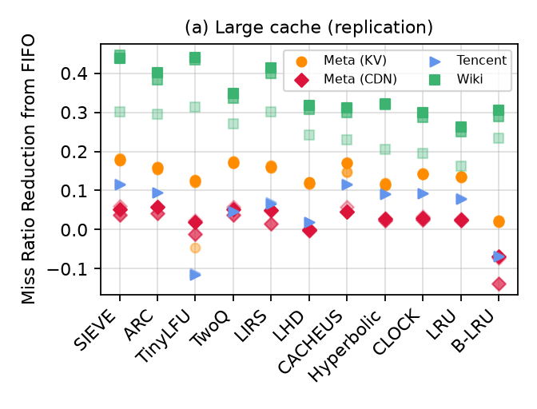
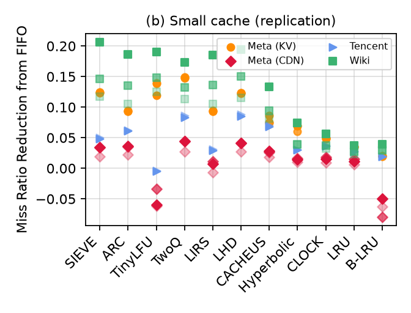

# Figure 4 (a) and (b): Meta KV, Meta CDN, Tencent Photo, Wiki CDN

| (a) large cache, 10% of the footprint | (b) small cache, 0.1% of the footprint |
|---|---|
|  |  |

Paper and replication side by side: [fig4_side_by_side.png](fig4_side_by_side.png).
All tables: [../results/summary.md](../results/summary.md). Per point: `comparison.csv`
(every trace × panel × algorithm, paper vs replication) and `sieve_ranks.csv`.

## What was run

| | paper | this replication |
|---|---|---|
| traces | Meta KV 5, Meta CDN 3, Tencent Photo 2, Wiki CDN 3 | the same 13 (Table 1 totals match; see below) |
| trace size | not stated | whole traces; Tencent Photo on a 10% spatial sample, which reproduces the paper's Tencent values (below) |
| cache size | 10% and 0.1% of the footprint (unique objects) | the same, as cachesim computes them (`results/stats/`) |
| object size | ignored | ignored (`--ignore-obj-size 1`) |
| simulator | libCacheSim | the snapshot in the authors' artifact (`external/NSDI24-SIEVE` @ `0346336`) |
| algorithms | 11 + FIFO baseline | FIFO, LRU, CLOCK, ARC, TwoQ, LIRS, LHD, CACHEUS, Hyperbolic, TinyLFU (W-TinyLFU, 1% window, SLRU), SIEVE, B-LRU (`lru -a bloom-filter`) |
| metric | miss ratio reduction from FIFO | (mr_FIFO − mr) / mr_FIFO, or (mr_FIFO − mr) / mr when worse than FIFO |

### Which trace is which dot

The paper tells a dataset's traces apart only by opacity. Each trace here was assigned to the
dot (1 = most opaque) that minimises the total difference over its 22 values
(`scripts/compare_fig4.py`); the assignment is unambiguous because SIEVE, LRU, CLOCK and others
then agree to 4 decimals.

| dataset | dot 1 | dot 2 | dot 3 | dot 4 | dot 5 |
|---|---|---|---|---|---|
| Meta KV | kvcache_traces_5 | kvcache_traces_1 | kvcache_traces_3 | kvcache_traces_4 | kvcache_traces_2 |
| Meta CDN | meta_rprn | meta_reag | meta_rnha | | |
| Tencent Photo | tencent_photo2 | tencent_photo1 | | | |
| Wiki CDN | wiki_2016u | wiki_2019u | wiki_2019t | | |

### Getting the traces

* **Meta CDN, Wiki, Tencent Photo:** `scripts/download.sh <dataset>/<file>` from the CMU PDL
  mirror (`ftp.pdl.cmu.edu/pub/datasets/twemcacheWorkload/cacheDatasets/`), checked with
  `zstd -t`.
* **Meta KV:** the mirror has the five 2022 traces only merged into one file. The five are
  Meta's `pub/kvcache/202206/kvcache_traces_{1..5}.csv` (`scripts/download_metakv.sh`),
  converted with libCacheSim's own `traceConv` (`scripts/convert_metakv.sh`: key = object,
  each row repeated `op_count` times, rows of size 0 dropped, time 0). `scripts/check_metakv.py`
  confirms that the five, one after another, are the mirror's merged file record by record
  (1,665,685,869 records; requests of size 0 are skipped by the simulator, leaving the
  1,644.8 M of Table 1).
* Table 1's Wiki row (3 traces, 2,863 M requests, 56 M objects) matches no combination of the
  public Wiki traces: 2019t + 2019u give its requests, 2016u + 2019t its objects. All three
  public traces were run, and each matches one of the paper's three Wiki dots exactly.

### Fitting whole traces into 11 GB

One cachesim process with all 11 algorithms at the large cache would need far more than
11 GB for the larger traces. Each trace was therefore run as several cachesim processes
("passes", `scripts/run_trace.sh`): all 11 algorithms at the small cache, the large cache split
into groups of algorithms planned from measured memory per object (`scripts/plan_groups.py`),
and B-LRU. Cache sizes are computed once per trace exactly as cachesim does
(`scripts/trace_stats.py`, which reproduces cachesim's footprint estimate) and passed as
absolute sizes. With several caches per process cachesim resets the random state for each
cache, so the grouping does not change results (`results/validation/split_check.tsv`).

### Tencent Photo: the 10% sample

Tencent's large cache (53 M objects per trace) does not fit in 11 GB for most algorithms, so it
was run on a 10% spatial sample (`cachesim -s 0.1`, which keeps the objects whose hash is
divisible by 10 and every request to them). The small cache was run both ways. The sample
reproduces the paper; the whole trace does not quite:

| Tencent photo1, small cache | paper | 10% sample | whole trace |
|---|---|---|---|
| SIEVE | 0.0501 | 0.0501 | 0.0503 |
| Hyperbolic | 0.0304 | 0.0304 | 0.0465 |
| B-LRU | 0.0196 | 0.0196 | 0.0098 |
| LHD | 0.0885 | 0.0883 | 0.0899 |
| sum of abs. differences, 11 algorithms | | 0.007 | 0.035 |

So the paper's Tencent dots are the 10% sample's, and the figure here uses the sample for both
panels. The whole-trace small-cache runs (`results/raw/tencentPhoto/tencent_photo{1,2}/`) and a
whole-trace large-cache run of FIFO, SIEVE, LRU and CLOCK on photo1
(`.../tencent_photo1.whole_large/`) are kept as a check; their effect on SIEVE is in
[../results/summary.md](../results/summary.md).

B-LRU on the whole Tencent trace needed `tools/blru_bitmap.c`: cachesim's "bloom-filter"
admission is an exact table of every object ever seen (> 11 GB for 529 M objects). The tool
computes the same admission (admit an object if it was requested before) with one bit per
request, from the trace's next-access field, and runs the same LRU. It equals cachesim's B-LRU
at all 10 cache sizes tested (`results/validation/blru_bitmap_check.tsv`).

## How to reproduce

From the repository root (WSL2/Linux, cmake, a C/C++ compiler, glib2 and zstd headers, python3):

```bash
scripts/build.sh                      # cachesim, traceConv, tools/blru_bitmap, Python venv
# traces
scripts/download.sh metaCDN/meta_reag.oracleGeneral.zst metaCDN/meta_rnha.oracleGeneral.zst \
    metaCDN/meta_rprn.oracleGeneral.zst wiki/wiki_2016u.oracleGeneral.zst \
    wiki/wiki_2019t.oracleGeneral.zst wiki/wiki_2019u.oracleGeneral.zst \
    tencentPhoto/tencent_photo1.oracleGeneral.zst tencentPhoto/tencent_photo2.oracleGeneral.zst \
    metaKV/202206_kv_traces_all.csv.oracleGeneral.zst
scripts/download_metakv.sh && scripts/convert_metakv.sh
.venv/bin/python -I scripts/check_metakv.py data/metaKV/202206_kv_traces_all.csv.oracleGeneral.zst \
    data/metaKV/kvcache_traces_{1,2,3,4,5}.oracleGeneral.zst
# simulations (resumable; trace stats are computed on the way). Keep a WSL terminal open:
# scripts/live.sh starts a tmux session with progress, auto-commit and top, and
# scripts/job.sh <name> <cmd> runs a command in a window of it.
scripts/run_queue.sh manifests/fig4.tsv            # Meta CDN, Wiki, Meta KV
scripts/run_queue.sh manifests/fig4_tencent.tsv    # Tencent (10% sample + whole-trace checks)
scripts/extra_tencent.sh                           # Tencent small cache on the 10% sample
# figure, comparison, tables
.venv/bin/python -I scripts/extract_paper_fig4.py paper/nsdi24-sieve.pdf -o paper/fig4_paper_values.csv
.venv/bin/python -I scripts/parse_logs.py results/raw -o results/fig4.csv
.venv/bin/python -I scripts/compare_fig4.py results/fig4.csv paper/fig4_paper_values.csv -o fig4
.venv/bin/python -I scripts/report_fig4.py
```

Two queues can run at once (`run_queue.sh` on different manifests or the same one): passes
are locked, and at most two cachesim processes run at a time. On this machine (Intel Core 7
240H, 8 threads, 11 GB RAM, WSL2) the whole figure took about 23 hours (42 hours of
simulation, two at a time); the longest traces were Wiki 2019u (8.9 h of passes), Wiki 2016u
(7 h) and the whole Tencent traces at the small cache (6.0 and 4.6 h).

## Result vs paper

**SIEVE.** Its reduction equals the paper's to 4 decimals on all 26 points (largest
difference 0.0001), and its rank among the 11 is the paper's on 25 of 26. The best algorithm
is the paper's on the same 25. Table: [../results/summary.md](../results/summary.md#sieve-on-every-trace).

**The one different rank: Tencent photo2, large cache.** SIEVE 0.1146 (paper 0.1147) is
second here because CACHEUS reaches 0.1150 (paper 0.0825).

**Which algorithms differ.** SIEVE, Hyperbolic, CLOCK and LRU agree with the paper to 0.0001
everywhere; LIRS, TwoQ and ARC to 0.0003; B-LRU to 0.0011; LHD to 0.0052 (Tencent, large
cache). Only two differ by more:

* **CACHEUS**: exact on most traces, but e.g. 0.299 vs 0.429 on Wiki 2019u (large), 0.115 vs
  0.083 on Tencent photo2 (large), 0.133 vs 0.183 on Wiki 2016u (small). CACHEUS draws a random
  learning rate when created; that was tested and is not the cause: forcing a different draw
  (`scripts/cacheus_draw.sh`) and a clock-seeded rerun give the same miss ratios to 4 decimals.
  The cause is not known; a likely one is that the paper's CACHEUS numbers came from a different
  version of libCacheSim's CACHEUS than the artifact's snapshot.
* **TinyLFU**: about +0.03 on Meta KV (large) and much less negative on Tencent (−0.12 vs
  −0.36 on photo2, large; −0.005 vs −0.125 small). Also unexplained.

Neither changes SIEVE's rank except on Tencent photo2 above.

**What the figure says about SIEVE (paper and replication alike).** At the large cache SIEVE
is the best algorithm on all Meta KV traces, one Meta CDN trace, one Wiki trace and the Tencent
traces (one of them here), and second to fourth elsewhere (ARC, CACHEUS or TinyLFU ahead by
0.0004–0.012). At the small cache TwoQ is best on Meta KV and Meta CDN and LHD on Tencent, with
SIEVE 2nd–5th, and SIEVE is best on Wiki 2016u. The paper's sentence "SIEVE outperforms all
other algorithms on all four datasets at the large cache size" is true of the datasets taken
as a whole, not of every trace.
