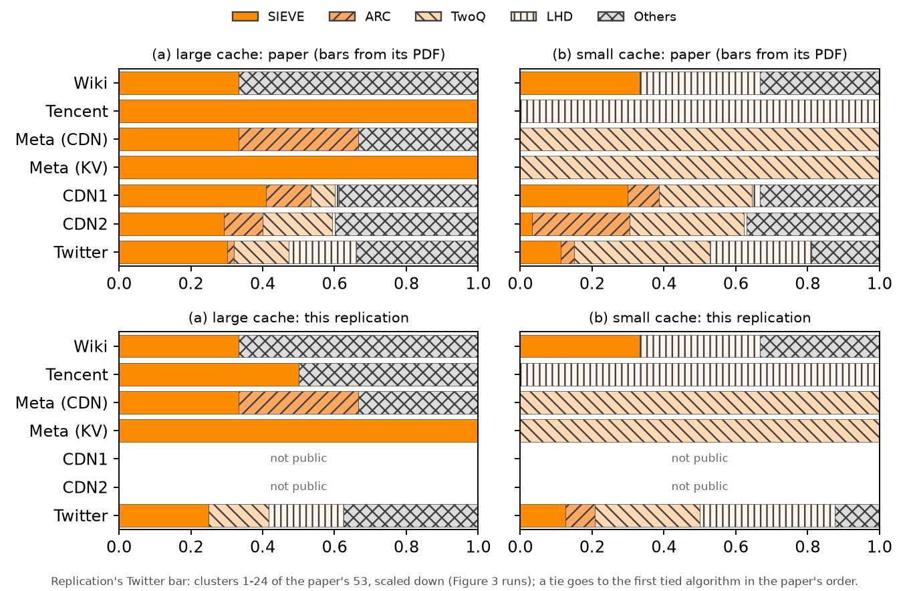

# Figure 5: best-performing algorithm per dataset



Top: the paper's Figure 5, redrawn from the bar values in its PDF. Bottom: this replication
([fig5.png](fig5.png) alone).

Figure 5 is not a separate experiment. For every trace and cache size it takes the best of the
11 algorithms (largest miss ratio reduction from FIFO) and shows, per dataset, the fraction of
traces each algorithm wins; SIEVE, ARC, TwoQ and LHD have their own colour, every other winner
is "Others". It is drawn from the per-trace results of Figures 3 and 4.

## Inputs

| dataset | traces | per-trace results |
|---|---|---|
| Wiki, Tencent, Meta (CDN), Meta (KV) | 3, 2, 3, 5 (all of the paper's) | this repository's Figure 4 runs, `results/fig4.csv` |
| Twitter | 24 (clusters 1–24; the paper: 53) | the Figure 3 replication, copied once to `results/fig5_inputs/twitter_fig3.csv` (sieve-fig3 @ `1d318f4`) |
| CDN1, CDN2 | – | proprietary, not public: not replicated |

No simulation was run for this figure. The Twitter clusters are the 24 of the Figure 3
replication, scaled down there to fit the machine (see that repository's README); the other 30
clusters were not run for Figure 3 and are not run here either.

The paper's Twitter bar has 53 traces, not 54: all its Twitter fractions are multiples of 1/53
(e.g. SIEVE 16/53 = 0.3019 at the large cache).

## Ties

cachesim prints miss ratios with 4 decimals. On 8 of the 24 Twitter clusters (12 of the 48
trace × size cases) several algorithms then have the same, lowest miss ratio. A tied trace goes
to the **first tied algorithm in the paper's plotting order** (SIEVE, ARC, TinyLFU, TwoQ, LIRS,
LHD, CACHEUS, Hyperbolic, CLOCK, LRU, B-LRU), which is what taking the first maximum in a
plotting script does; the paper does not say how it breaks ties. 7 of the 12 ties include SIEVE
and therefore go to SIEVE. Every tie is listed in `results/fig5_best.csv` (column `tied`).
Meta, Tencent and Wiki have no ties.

## How to reproduce

After the Figure 4 runs (see [../fig4/README.md](../fig4/README.md)):

```bash
.venv/bin/python -I fig5/extract_paper_fig5.py paper/nsdi24-sieve.pdf -o paper/fig5_paper_values.csv
.venv/bin/python -I fig5/fig5.py
```

`fig5/extract_paper_fig5.py` reads the bars from the PDF's vector drawing: SIEVE segments
are filled rectangles, the hatched segments are the clip rectangles of their pattern fills; the
axis ends coincide with the "0.0" and "1.0" tick labels and every bar sums to 1.0000.
`fig5/fig5.py` writes `results/fig5_best.csv` (best algorithm per trace and size),
`results/fig5_bars.csv` (bar fractions) and the two figures.

## Result vs paper

| | large cache (a) | small cache (b) |
|---|---|---|
| Wiki | equal (SIEVE 1/3, Others 2/3) | equal (SIEVE, LHD, Others 1/3 each) |
| Tencent | **SIEVE 1/2, Others 1/2** (paper: SIEVE 1) | equal (LHD 1) |
| Meta (CDN) | equal (SIEVE, ARC, Others 1/3 each) | equal (TwoQ 1) |
| Meta (KV) | equal (SIEVE 1) | equal (TwoQ 1) |
| Twitter | close, see below | close, see below |

**Meta, Tencent, Wiki: 7 of the 8 bars are the paper's exactly.** The paper's own Figure 4
dots give exactly its Figure 5 bars for these four datasets (`results/fig5_bars.csv`, source
"paper Figure 4 dots"), so these bars follow directly from Figure 4. The one difference is
Tencent at the large cache: on Tencent photo2 this simulator's CACHEUS (0.1150) beats SIEVE
(0.1146; paper: SIEVE 0.1147, CACHEUS 0.0825), the one rank difference of the Figure 4
replication.

**Twitter: same pattern, not the same numbers.**

| Twitter | SIEVE | ARC | TwoQ | LHD | Others |
|---|---|---|---|---|---|
| (a) paper, 53 clusters | 0.302 | 0.019 | 0.151 | 0.189 | 0.340 |
| (a) replication, 24 clusters | 0.250 | 0.000 | 0.167 | 0.208 | 0.375 |
| (b) paper, 53 clusters | 0.113 | 0.038 | 0.377 | 0.283 | 0.189 |
| (b) replication, 24 clusters | 0.125 | 0.083 | 0.292 | 0.375 | 0.125 |

As in the paper, SIEVE wins the largest share of single algorithms at the large cache and a
small share at the small cache, where TwoQ and LHD win most traces. With 24 clusters each
cluster is 4% of the bar, so differences of a cluster or two (0.04–0.08) are expected, on top
of the scaled-down traces and the tie rule.
