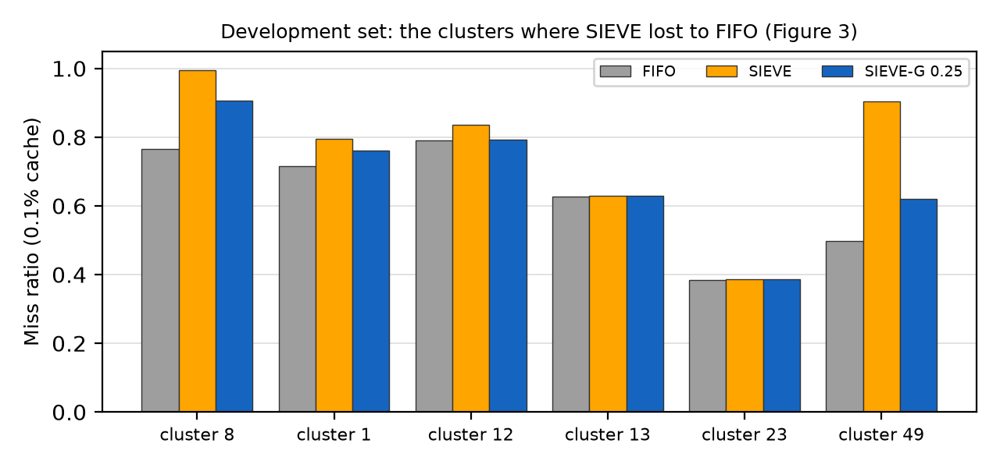
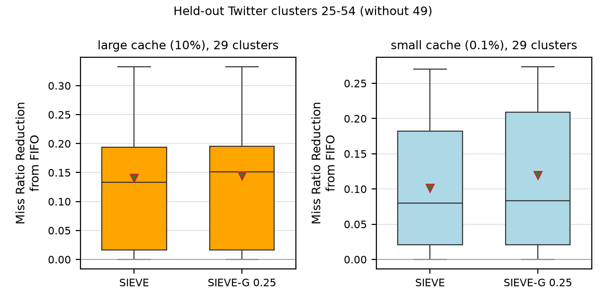
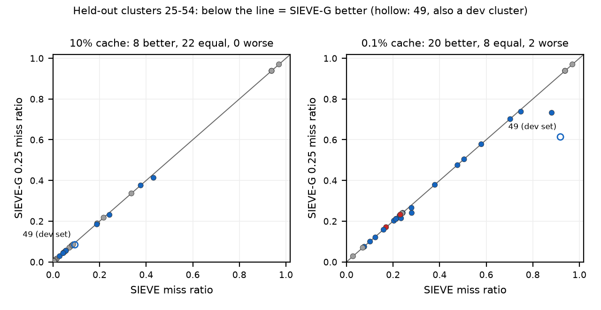
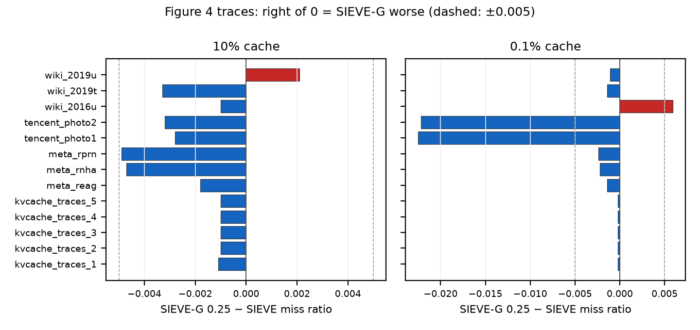

# SIEVE-G: SIEVE with a ghost list

An improvement to SIEVE for small caches, evaluated with the simulator and traces of the SIEVE
replication in this repository (Figures 3 and 4), with a pre-registered held-out test.

## Problem

In the Figure 3 replication, at the small cache (0.1% of the footprint) SIEVE is **worse than
FIFO** on several Twitter clusters. SIEVE's hand evicts a newly inserted object as soon as it
reaches it unless the object was requested again, so with a small cache new objects can be
evicted before their second request, again and again:

| cluster (Figure 3 trace version) | small cache | FIFO | SIEVE |
|---|---|---|---|
| 8 (full, first 1 B requests) | 267 objects | 0.7660 | **0.9942** |
| 49 (sample10, sampling validation) | 159 | 0.4974 | **0.9044** |
| 1 (full, first 1 B requests) | 63 | 0.7166 | **0.7957** |
| 12 (sample100) | 20,949 | 0.7907 | **0.8366** |
| 23 (sample100) | 14,424 | 0.3851 | **0.3864** |
| 13 (sample100) | 5,187 | 0.6279 | **0.6285** |

(Cluster 8 also loses at the 10% cache: SIEVE 0.5396 vs FIFO 0.4160.)

## Design

**SIEVE-G** is SIEVE plus a bounded FIFO "ghost" of the ids of recently evicted objects (ids
only, no data). On a miss, if the object's id is in the ghost, it is inserted with its visited bit
already set (`freq = 1`) and leaves the ghost, so the hand keeps it for one more round. Everything
else is unchanged SIEVE. The ghost holds `ratio × cache size` ids; ratio 0 is exactly SIEVE.

* Code: `patches/SIEVE-G.patch` (top level of the repository), applied by
  `scripts/setup_simulator.sh` on top of the artifact `0861f82` and the build fix:
  `cache/eviction/SieveG.c` (Sieve.c + the ghost; the ghost follows S3FIFO's `fifo_ghost`), the
  declaration in `evictionAlgo.h`, the name in `cache_init.h` (`sieveg`, `sieveg-<ratio>`), and
  `CMakeLists.txt`. No other algorithm is changed.
* Optional lean ghost (Phase 6): `patches/SIEVE-G-fp.patch`, `sieveg-fp-<ratio>` (below).

## Correctness gates ([tests/README.md](tests/README.md))

| gate | result |
|---|---|
| G1: no ghost equals SIEVE (Zipf α 0.8/1.0/1.2, 3 cache sizes) | pass: 9 of 9 identical |
| G2: objects requested exactly twice, `gap` apart | expectation **not met**, explained: on such a trace a ghost hit cannot become a cache hit (the ghost marks the second request, there is no third), and SIEVE only fails when the gap approaches the cache size; kept as specified, not tuned |
| G3: A B C A B C, cache 2 | pass: evicted objects come back with `freq = 1` |
| G4: baseline unchanged (cluster 13) | pass: identical to the Figure 3 logs |

## Development set and the frozen ratio ([PREREGISTRATION.md](PREREGISTRATION.md))

The six clusters above, Figure 3 trace versions, `fifo,sieve,sieveg-0.25,sieveg-0.5,sieveg-1.0`
in one pass ([results/dev_table.md](results/dev_table.md)). FIFO and SIEVE equal the Figure 3
logs in all 24 values (cluster 8 at Figure 3's cache sizes: cachesim's footprint estimate for this
1-billion-request prefix varies between runs, 267,246 vs 268,963 objects, so the run uses
Figure 3's absolute sizes; the first run is kept as `results/dev_cluster8_estimated_sizes.log`).



| 0.1% cache | FIFO | SIEVE | SIEVE-G 0.25 | 0.50 | 1.00 |
|---|---|---|---|---|---|
| cluster 8 | 0.766 | 0.994 | 0.906 | 0.890 | 0.885 |
| cluster 49 | 0.497 | 0.904 | 0.620 | 0.614 | 0.604 |
| cluster 1 | 0.717 | 0.796 | 0.761 | 0.750 | 0.744 |
| cluster 12 | 0.791 | 0.837 | 0.792 | 0.792 | 0.792 |

**Frozen ratio: 0.25**, by the plan's rule (best mean reduction at 0.1% among the ratios not
worse than SIEVE on any dev cluster at 10%). Taken literally ("not higher at all") no ratio
qualified: all were 0.0001–0.0003 above SIEVE on cluster 1 at 10% (0.0052–0.0054 vs 0.0051). The
plan's own definition of "worse" (by > 0.0001, from its pass rule) was used, which leaves only 0.25,
not the ratio with the best development numbers (1.0). This deviation is stated in the
pre-registration, which was committed before any held-out run.

## Held-out verdict: **PASS** at both cache sizes ([results/verdict.md](results/verdict.md))

Twitter clusters 25–54, never used for any decision, trace versions by the Figure 3 rule
(`manifests/heldout.tsv`; identical to Figure 3's choices; all 30 run, none skipped).
`fifo,sieve,sieveg-0.25`. Primary set: **29 clusters, without cluster 49**, which is also a
development cluster (pre-registered); all 30 as secondary.

| set | cache | mean rel. reduction vs SIEVE | median | better / equal / worse | worse share | verdict |
|---|---|---|---|---|---|---|
| primary (29) | 0.1% | +1.90% | +0.21% | 19 / 8 / 2 | 7% | **PASS** |
| primary (29) | 10% | +0.45% | 0.00% | 7 / 22 / 0 | 0% | **PASS** |
| secondary (30) | 0.1% | +2.94% | +0.23% | 20 / 8 / 2 | 7% | PASS |
| secondary (30) | 10% | +0.77% | 0.00% | 8 / 22 / 0 | 0% | PASS |

Pass rule: mean > 0, median ≥ 0, worse (by > 0.0001) on ≤ 25% of clusters. The two worse
clusters lose little (cluster 30 +0.0009, cluster 47 +0.0014 in miss ratio at 0.1%); the largest
gains are where SIEVE failed (cluster 49: 0.919 → 0.614; cluster 50: 0.881 → 0.732).




## Figure 4 check ([results/fig4_check.md](results/fig4_check.md))

The 13 Figure 4 traces (Meta CDN 3, Meta KV 5, Wiki 3, Tencent 2 on its 10% sample), versions as
in Figure 4. SIEVE equals `external/sieve-fig4/results/fig4.csv` on **all 26** trace × size
points. SIEVE-G is better on 24 of 26 (e.g. Tencent at 0.1%: −0.022 on both traces) and worse on
2: **Wiki 2016u at 0.1%: +0.0059, flagged** (> 0.005), and Wiki 2019u at 10%: +0.0021.



## Cost

* **Memory.** The ghost holds 0.25 × cache size ids. Stored as libCacheSim stores it (a FIFO
  cache of `cache_obj_t`, 80 bytes, plus a hash-table pointer) that is about 0.25 × 88 ≈ **22
  bytes per cached object**; a plain id set would need 0.25 × 8 = **2 bytes per cached object**
  plus hash-set overhead, against SIEVE's 1 bit per object (its visited bit).
* **Time** (`results/runtime.tsv`; each algorithm alone, one thread, one run each, so rough):
  exact SIEVE-G is 1–5% slower than SIEVE in 3 of 4 cases and 55% slower on cluster 12 at 10%
  (a ghost of ~520,000 ids); the fingerprint ghost takes about SIEVE's time (−11% to +8%). Peak
  memory: the exact ghost adds 130–160 MB even for tiny caches, because libCacheSim gives every
  cache (the ghost too) a preallocated hash table; the fingerprint ghost adds nothing measurable.

## Phase 6 (optional): lean fingerprint ghost

`sieveg-fp-<ratio>` (`patches/SIEVE-G-fp.patch`, on top of `SIEVE-G.patch`): the ghost keeps
16-bit fingerprints of evicted ids (low 16 bits of the id's hash) in a ring buffer, and a count per
fingerprint value for the membership test: **2 bytes per ghost entry** (0.5 byte per cached object
at ratio 0.25) plus a fixed 256 KB, instead of ~88. Same frozen ratio, 0.25. Gates
([tests/fp/fp_gates.log](tests/fp/fp_gates.log)): G1 9 of 9 identical to SIEVE with no ghost, G3 3
ghost hits like the exact ghost, G4 unchanged; on Zipf within 0.0013 of the exact ghost.
Held-out run ([results/heldout_fp.csv](results/heldout_fp.csv); FIFO, SIEVE and exact SIEVE-G in
the same runs are identical to Phase 4a in all 180 values), primary 29 clusters, by the
pre-registered rule:

| cache | fingerprint SIEVE-G vs SIEVE: mean | median | better / worse | rule |
|---|---|---|---|---|
| 0.1% | +1.82% | +0.10% | 17 / 4 | pass (close to the exact ghost) |
| 10% | **−1.70%** | 0.00% | 2 / **12** | **fail** |

The fingerprint ghost fails at the large cache, as anticipated before the run: with
0.25 × cache size ghost entries and only 65,536 fingerprint values, 20 of the 30 clusters need
more entries than there are fingerprints at 10%; most fingerprints are then present and many new
objects are wrongly taken as returning (cluster 34: 0.306 vs 0.231 for the exact ghost). In G2,
the same false matches even lowered the miss ratio at gap 800 (0.970 vs 0.999), which is not the
mechanism working. So 16-bit fingerprints suit small ghosts only; large caches need wider
fingerprints (or a bucketed filter). Phase 6 is not part of the pre-registered verdict.

## Limitations

* Twitter only partly: 6 development + 30 held-out of the 54 clusters (clusters 2–7, 9–11,
  14–22, 24 were not run with SIEVE-G), and Twitter traces are scaled down by the Figure 3 rule
  (sampled versions or the first 1 B requests), as in the replication.
* One frozen ratio; the ghost size is relative to the cache, untested beyond 0.25/0.5/1.0.
* Static Zipf workloads (G1's traces): SIEVE-G 0.25 is slightly **worse** than SIEVE (up to
  +0.014 at α = 0.8 and 10%), since with a fixed popularity the evicted objects really are
  unpopular and the ghost readmits some of them; the gain is on real traces with recurring
  objects that SIEVE evicts too early.
* Simulation only (libCacheSim, object size ignored, miss ratio only); no CacheLib / concurrency
  implementation, no throughput or latency measurement on a real cache.

## How to reproduce

From the repository root, after cloning with `--recurse-submodules`:

```bash
scripts/setup_simulator.sh                    # artifact + build fix + SIEVE-G (+ fp) patches
(cd external/NSDI24-SIEVE/libCacheSim && mkdir -p _build && cd _build && cmake -DCMAKE_BUILD_TYPE=Release .. && make -j cachesim)
cd external/sieve-g
python3 -m venv .venv && .venv/bin/pip install -r ../../requirements.txt
# traces: data/twitter/... (Figure 3's files) and data/fig4/... (Figure 4's); see manifests/
tests/gates.sh g1 && tests/gates.sh g2 && tests/gates.sh g4
scripts/run_queue.sh manifests/dev.tsv                                    # Phase 3 (cluster 8: SIZES=267,26724)
.venv/bin/python -I scripts/parse_logs.py results/dev/*.log --dataset dev -o results/dev.csv
.venv/bin/python -I scripts/dev_report.py
ALGOS=fifo,sieve,sieveg-0.25 scripts/run_queue.sh manifests/heldout.tsv    # Phase 4a
ALGOS=fifo,sieve,sieveg-0.25 scripts/run_queue.sh manifests/fig4check.tsv  # Phase 4b
.venv/bin/python -I scripts/analyze.py                                    # Phase 5
```

Run times on the laptop used (Intel Core 7 240H, 8 threads, 11 GB, WSL2): development set ~30 min (with the cluster 8 rerun),
held-out 41 min (peak 2.7 GB), Figure 4 check 2 h (Wiki and Tencent ~25–30 min each).
